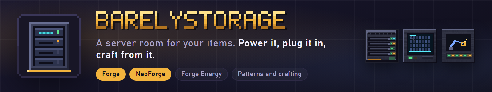
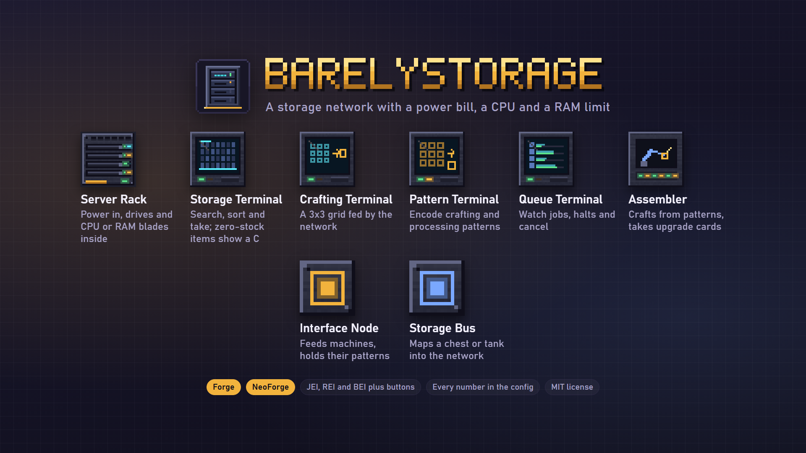
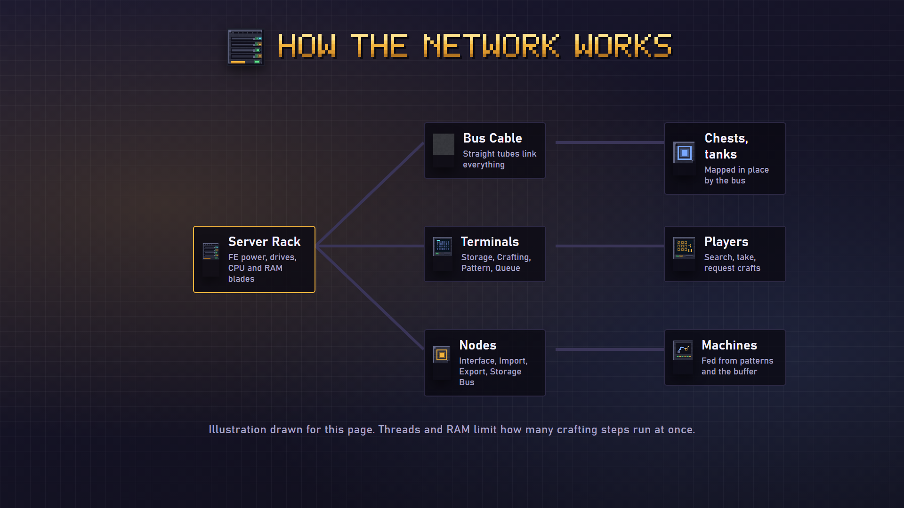

**A server room for your items: racks, drives, terminals and pattern crafting for Forge and NeoForge.**

BarelyStorage is a physical storage network. A Server Rack takes Forge Energy and holds drive cartridges and CPU or RAM blades. Bus cables link it to terminals, nodes and assemblers. The network has a power bill, and crafting is limited by how many threads and how much RAM your racks offer, so a bigger factory means bigger hardware.

# Features

- **Server Rack:** takes FE, holds up to 8 drive cartridges and 4 blades, and goes offline when it cannot pay its upkeep.
- **Drive cartridges:** Iron, Steel, Gold, Obsidian and Quantum. They keep their items inside the item, so you can carry a full drive.
- **Storage Terminal:** a scrolling, searchable list with sort, view and theme buttons. Click takes one item, shift-click takes a stack. Items you can craft but have none of show a C and open a request window.
- **Crafting Terminal:** a 3x3 grid that draws from the network first, then your inventory. Missing ingredients turn red.
- **Pattern Terminal:** encodes crafting and processing patterns, with a Tags toggle that lets tag alternatives stand in.
- **Crafting Queue Terminal:** shows running jobs and halts, and lets you cancel.
- **Assembler:** crafts from patterns and takes up to four upgrade cards.
- **Interface, Import and Export Nodes, and the Storage Bus:** feed machines, pull items in, push items out and map a chest or tank into the network. Each has an upgrade and filter screen.
- **Upgrade cards:** Speed, Capacity, Efficiency and Filter.
- **CPU and RAM blades:** the Basic Core, the Multi-Threaded RAM Blade and the Quantum Core set threads, RAM and how deep a pattern chain can go. Run out and the job halts with Thread Exhaustion or Out of Memory until you add hardware.

# Settings

Power use, drive sizes, hardware, crafting speed and node speed are all in `config/barelystorage.properties`.

# Compatibility

- Takes plain Forge Energy through the loader's energy interface, so any cable mod can feed a rack.
- The plus button of JEI, REI and BEI fills the Crafting Terminal's grid or encodes a pattern in the Pattern Terminal. JEI and REI work on NeoForge only for now.
- The terminal's search can follow the recipe viewer's search box (JEI, REI and BEI), both ways.
- Optional Show Me What This Is plugin for racks, nodes and assemblers.
- EMI has no build for these Minecraft versions yet.

The pictures on this page are illustrations drawn for the listing, not game screenshots.

**Tested:** every layer (Forge and NeoForge on 26.1.2, 26.2 and 26.3) compiles and passes a headless server self test of 32 checks (storage, priority routing, nodes, filters, patterns and crafting, hardware halts, terminal clicks, power) plus 32 unit tests of the shared logic. Each layer was run in a real client with a scripted tour that photographs the room and every screen. The BEI plus button and the BEI search sync were checked in a real client on NeoForge 26.2 only. The JEI and REI hooks compile but were not tried in a game. The Show Me What This Is lines, taking items out through the terminal in a real client, multiplayer and long play sessions have not been checked yet.

# FAQ

**Does it need to be on the server?** Yes, on the server and on every client.

**Does it need another mod?** No. Item viewers and Show Me What This Is are optional.

**Can I change the numbers?** Yes, in the config file.

**Fabric?** Not at this time.

**Can I use it in my modpack?** Yes. It is MIT licensed.

Made by ItMeCasey Studios. Source and issues on [GitHub](https://github.com/ItMeCasey/BarelyStorage).
